# Almatafi

**Is this fire season normal?** Twenty-five years of satellite fire detections from MODIS and VIIRS, on one consistent record.

NASA Space Apps Cairo 2026 · Challenge: *Harmonization of MODIS and VIIRS Hot Spots* (authored with CONAE, Argentina)

**Live site: https://almatafi.monitorthesituations.com** (no login) · [30-second demo video](https://youtu.be/sRcld90Jnzo) · [NASA Space Apps project page](https://www.spaceappschallenge.org/2026/find-a-team/almatafi/?tab=project) · [Method](docs/method.md)

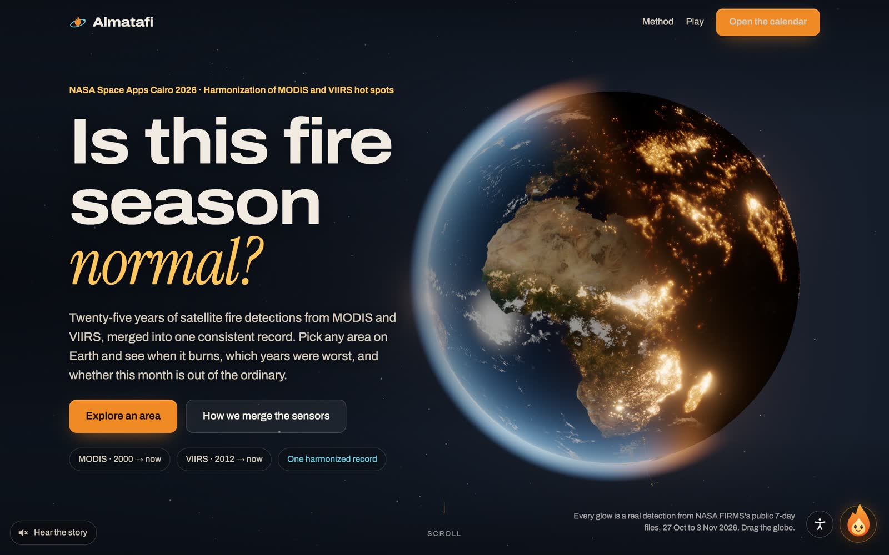

> **Data status.** The method and the app are complete and tested. The 25-year record on the live site still runs on a simulated data set in the exact FIRMS file format, and the site says so. The globe's week of fires, the map imagery, the cloud cover and the live hotspots are real NASA data. Building the record from the real FIRMS archive is the next step.

## Try it in two minutes

1. On the home page, press **Open Río Negro, July 2026** and read the answer at the top. Then click any other month in the calendar.
2. Open the **Nile Delta** and switch between **MODIS only**, **VIIRS only** and **Harmonized**. The same fires give different counts. The slider under the map shows the fix.
3. Press **Play** and try one chapter of the game.

## The problem

NASA has watched fires from orbit since 2000, with two different sensors:

| | MODIS | VIIRS |
|---|---|---|
| Since | 2000 (Terra), 2002 (Aqua) | 2012 (Suomi NPP), then NOAA-20 and NOAA-21 |
| Pixel | 1 km | 375 m |
| Sees | larger, hotter fires | small and cool fires too |

VIIRS reports several times more hotspots for the same fires. In the real FIRMS week of 27 October to 3 November 2026, VIIRS on NOAA-20 reported **300,095** detections and MODIS on Terra and Aqua **58,127**; over the Nile Delta it was 88 against 7. Joined as they are, the two records show fire seeming to explode in 2012, and no month before 2012 can be compared with one after it.

| Raw join: MODIS, then VIIRS glued on | The same years on our record |
|---|---|
| 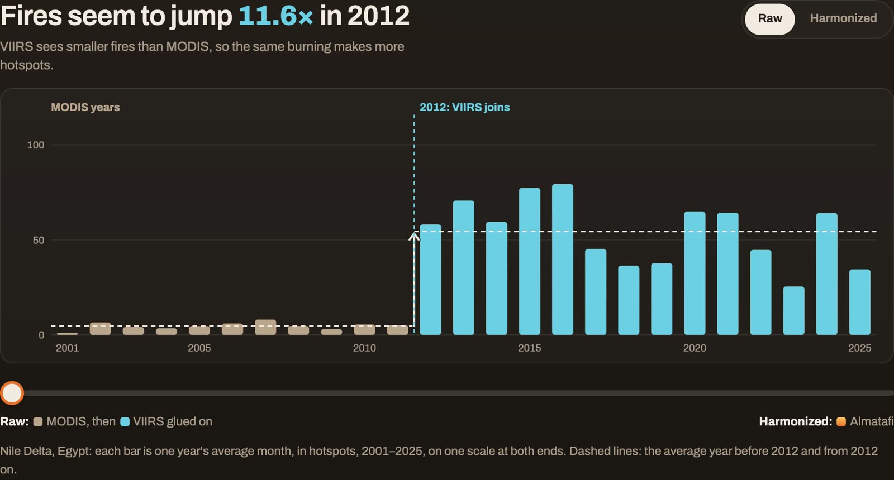 | 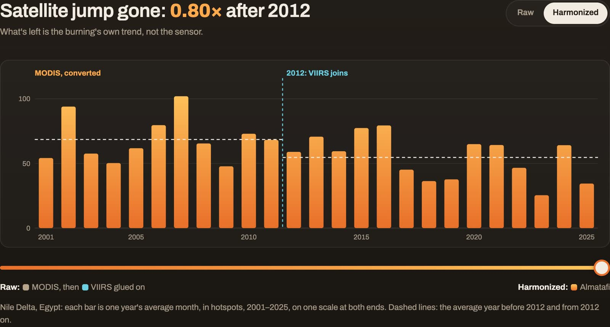 |

## What it does

Pick any area on Earth: draw a polygon or a box, search a place, choose a province, or type a latitude and longitude. Almatafi shows:

- **The answer in one sentence**, for example "October 2026: 589 hotspots. Unusually high: 2.4 times a typical October, and the most for October in 26 years."
- **A burning calendar**: every month since 2001, years by months.
- **Statistics** for the chosen month: typical value, usual range, rank, percentile, z-score and the long-term trend.
- **A map** of the individual hotspots with their details, each detection's pixel footprint, the satellite image of that day and a smoke layer.
- **Downloads**: hotspots as CSV, GeoJSON or KML, the calendar as CSV, the 0.1° grid as a Cloud-Optimized GeoTIFF, and a share link that reopens the same view.

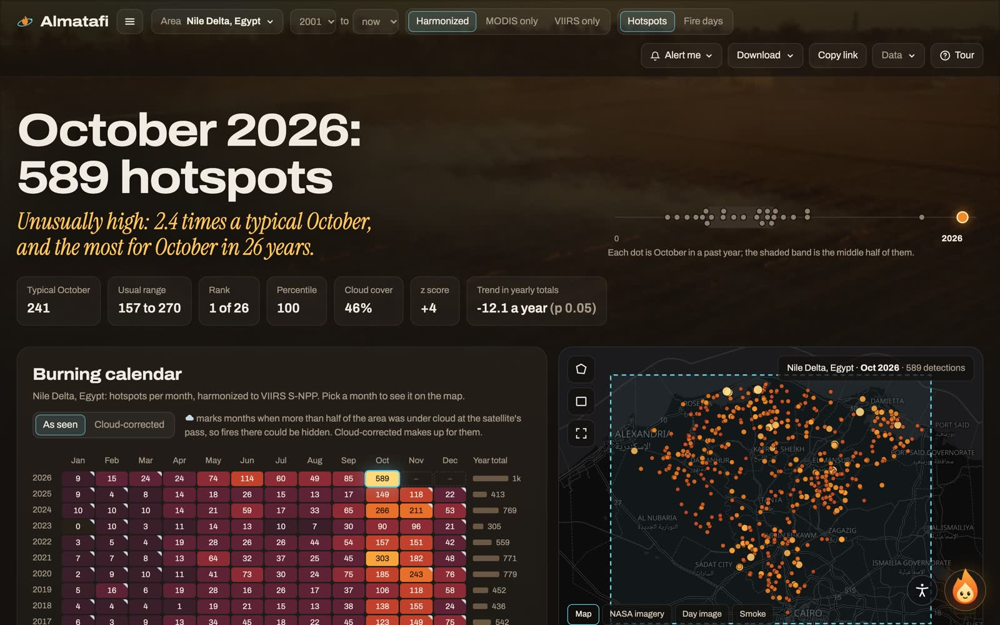

The challenge's own case, Río Negro in July 2026, against every July since 2001:

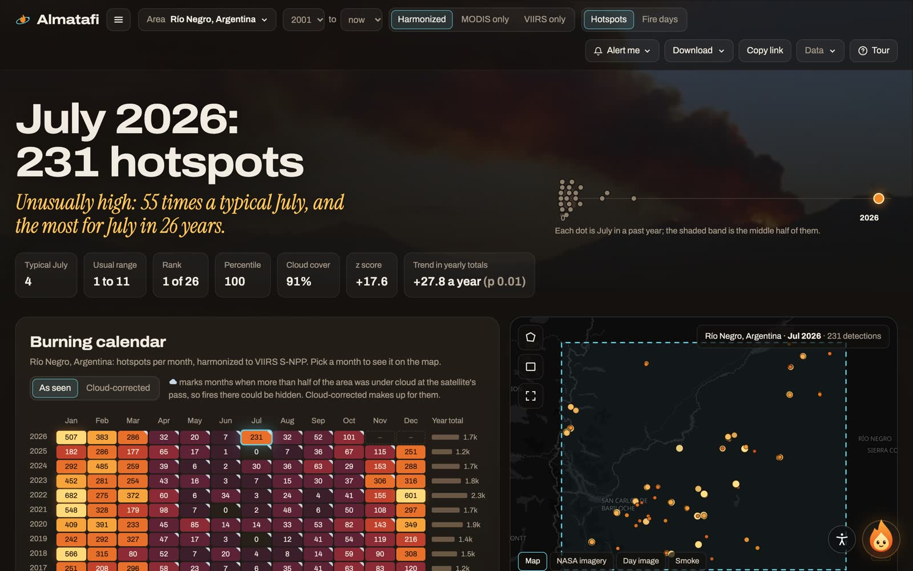

## How it works

1. **Clean.** Low-confidence detections are dropped. Only vegetation fires are kept; cells flagged again and again as gas flares, industry or volcanoes are masked.
2. **Common grid.** Both sensors are counted on the same global 0.1° grid (about 10 km), per month, satellite and day or night pass, as detections and as fire days. This removes the pixel-size difference.
3. **Sensitivity.** VIIRS detections are split at the fire power MODIS needs to see a fire. Fires above that floor convert from MODIS by a ratio learned per 10° tile and calendar month. Fires below it, which MODIS cannot see, come from each cell's own VIIRS record, scaled by how active that year was.
4. **Overpass time.** Aqua is calibrated against VIIRS (same 13:30 pass) on 2012 to 2022, and Terra (10:30) against Aqua on 2003 to 2011, day and night separately. NOAA-20 and NOAA-21 carry the record since Suomi NPP stopped on 2 November 2026.
5. **Model choice.** Four conversion models are scored by leave-one-year-out, and the best one is used.
6. **Analysis.** An area's count is the sum of its cells. Each month is compared with the same month in the other years: percentile, z-score, and Sen's slope for the trend.
7. **Clouds (optional).** Counts can be divided by the clear-sky share from NASA's daily MODIS cloud fraction, capped at five times.

The full method, with formulas and sources: [`docs/method.md`](docs/method.md).

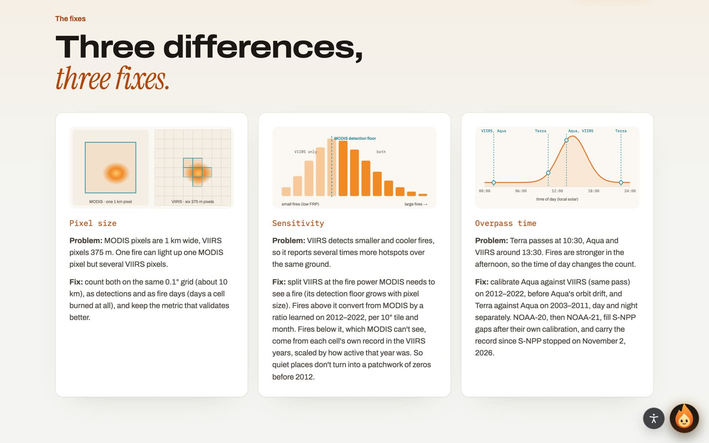

## Does it work?

The pipeline was developed on a simulated data set with known true fires, which each simulated sensor sees with its own pixel size, sensitivity and overpass time. Because the truth is known, the method can be checked against it.

| Test | Result (simulated data) |
|---|---|
| Leave-one-year-out: predict VIIRS from MODIS for years left out of the fit | R² 0.976 on 1,341 tile-month totals (0.968 on 1° areas) |
| Break at 2012: hotspots after ÷ before | raw join 4.61×, our record 1.03× |
| Pettitt change-point test | raw join p = 0.0003 (a break), our record p = 0.85 (none) |
| Placebo break years inside one sensor's era (2005, 2007, 2017, 2020) | 0.85× to 1.08×, so 1.03× at 2012 is ordinary |
| Against the known true fires, per region | raw join 3.2× to 15.0×, our record 0.95× to 1.08× |

On real NASA data so far: real FIRMS country files (MODIS 2010 for Egypt, Argentina and Chile; VIIRS 2019 for Egypt) pass through the cleaning step with no row rejected. The code has 559 automated tests that run on every change.

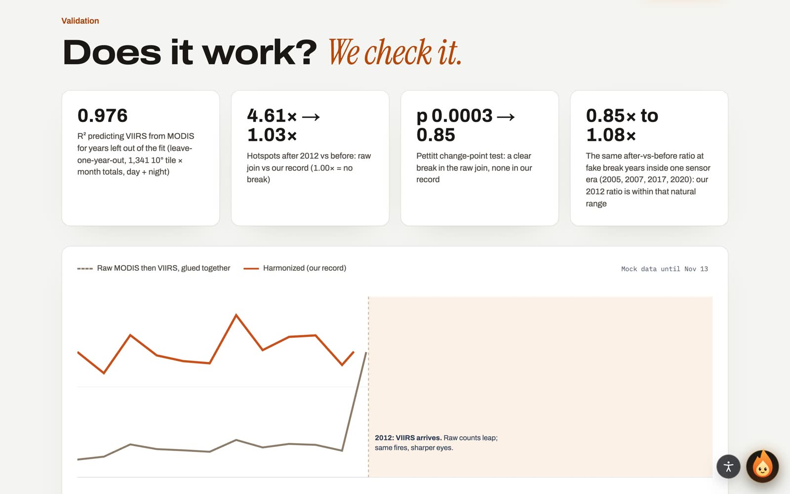

## For everyone, not only experts

| | |
|---|---|
| 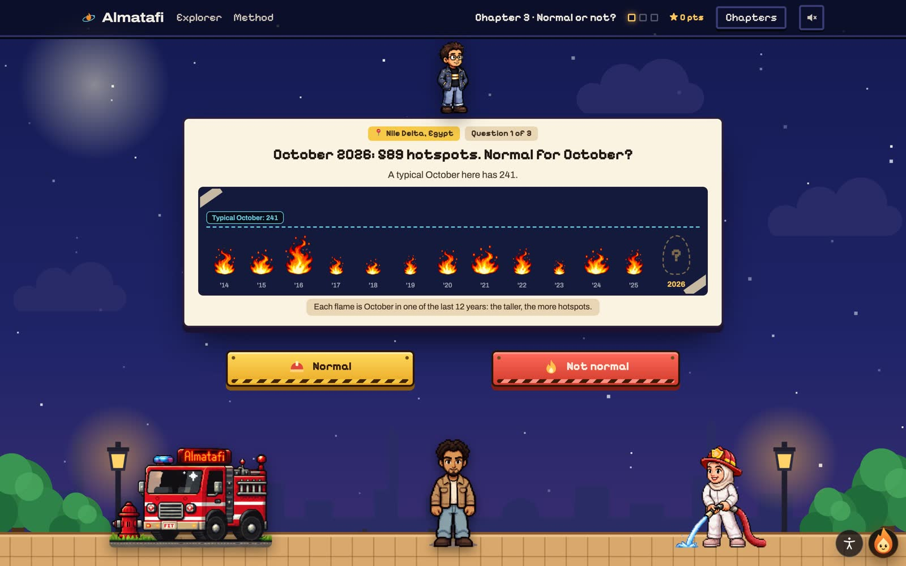 | **Normal or not?** A five-chapter game with 14 questions: what a hotspot is, why two satellites disagree, and how to tell a strange fire season from a normal one. |
| 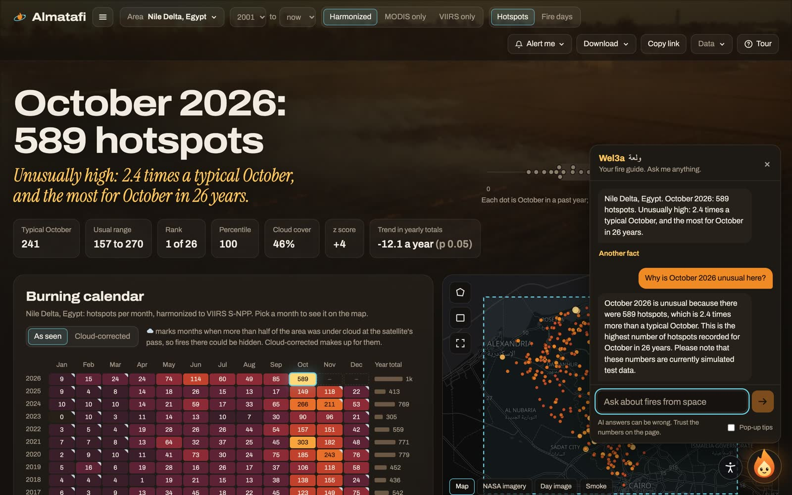 | **Wel3a**, a flame guide on every page: written tips, and a chat that answers from a fixed fact sheet and the numbers on screen. |
| 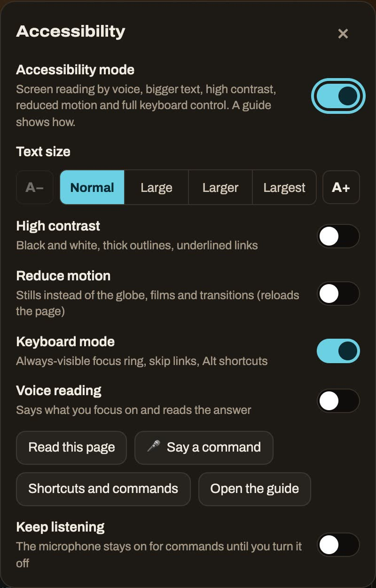 | **Accessibility mode**: text size, high contrast, reduced motion, keyboard mode, voice reading and voice commands, with a guided introduction. Details below. |

Also: a guided tour of the explorer, a narrated story on the home page with captions, and an offline copy of the two demo regions if the server cannot be reached.

## Accessibility tools

One round button on every page (bottom right, or `Alt + A`) opens the accessibility panel. With the mode off, the site is unchanged. With it on, the choices are remembered on the device.

| Tool | What it does |
|---|---|
| **Text size** | Normal, Large, Larger or Largest. All text grows, including the calendar's numbers; the map keeps its size. |
| **High contrast** | Pure black and white, thick outlines, underlined links, no scenery behind the numbers. |
| **Reduce motion** | Still images instead of the 3D globe, the films and the page transitions. |
| **Keyboard mode** | An always-visible focus ring, skip links on every page (content, the answer, calendar, map, downloads), arrow keys between months, and the `Alt` shortcuts. |
| **Voice reading** | Says what you land on (name, kind of control, state), reads the answer when the month changes, announces each new page. "Read this page" reads from the top; `Escape` stops. |
| **Voice commands** | "open the explorer", "method", "play the game", "home", "read the page", "stop", "bigger text", "smaller text", "high contrast", "contrast off", "reduce motion", "Nile Delta", "Río Negro", "next month", "previous month", "show MODIS / VIIRS / harmonized", "click" + a button's name, "help". "Keep listening" leaves the microphone on. |
| **Shortcuts** | `Alt + A` panel · `Alt + K` shortcut list · `Alt + R` read the page · `Alt + V` voice on or off · `Alt + M` listen for a command · `Alt + +` / `Alt + −` text size · `Alt + 1 / 2 / 3 / 4` story, explorer, Method, game |
| **Guide** | Six steps with the real controls inside each one; opens the first time the mode is turned on and again from the panel. |

Voice reading and voice commands use the browser's own speech features (Chrome, Edge and Safari).

| The shortcut and command list | High contrast with Larger text |
|---|---|
| 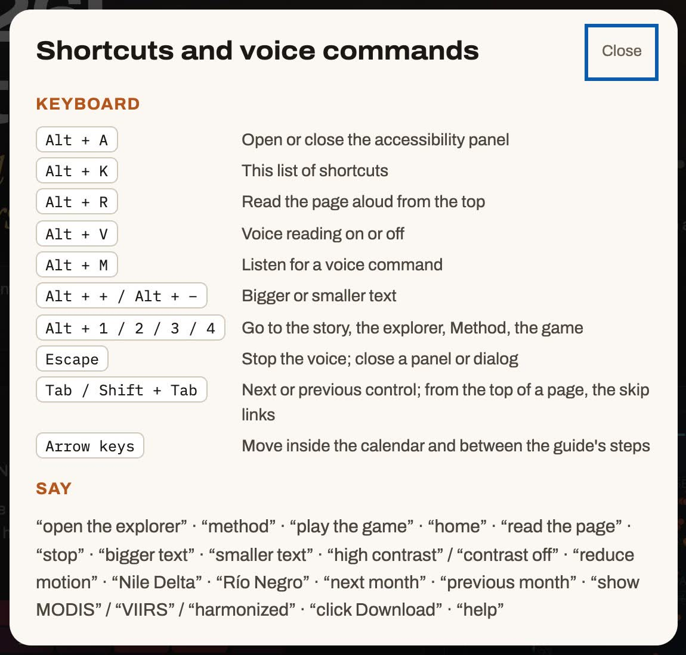 | 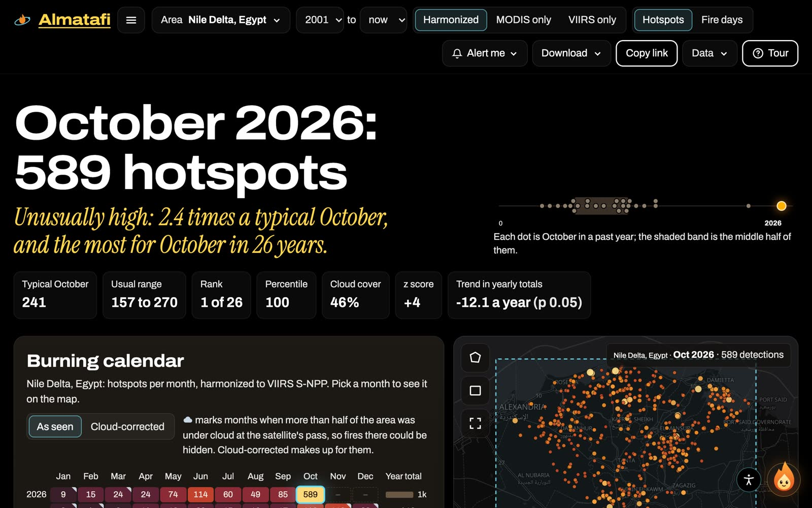 |

## Limits

- The record on the live site is simulated for now (see **Data status** above).
- A hotspot is not a fire, and no hotspot is not proof of no fire: clouds, smoke, small fires and timing hide fires. The calendar counts detections, not burned area.
- The record sits on a 0.1° grid, so areas under four cells are coarse and get a warning.
- January 2001 to June 2002 has Terra only; single months there are less reliable where fires burn in the afternoon.
- The cloud-corrected view leans high; read it as an upper bound.
- "Alert me" shows a preview of the alert email; no email is sent yet.

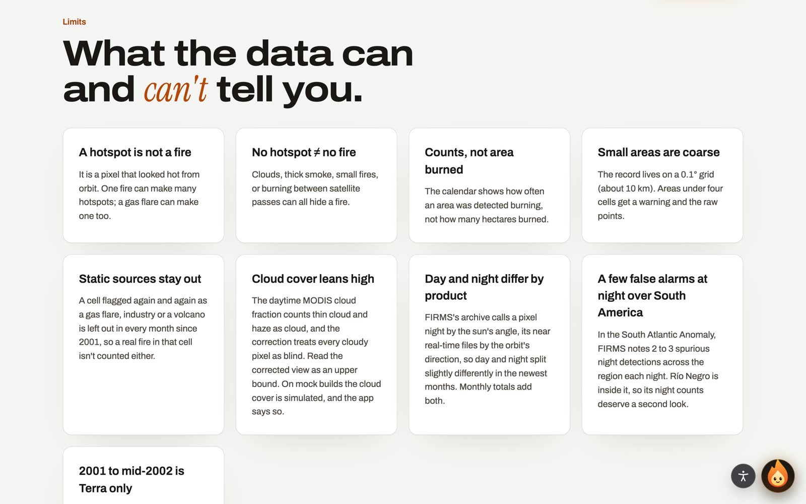

## NASA data and resources

| Resource | Used for |
|---|---|
| [NASA FIRMS](https://firms.modaps.eosdis.nasa.gov/): MODIS Collection 6.1 active fires (Terra, Aqua) | One half of the record; the globe's week; format and cleaning checks on real country files |
| [NASA FIRMS](https://firms.modaps.eosdis.nasa.gov/active_fire/): VIIRS 375 m active fires (Suomi NPP, NOAA-20, NOAA-21) | The other half, and the unit the record is expressed in |
| [FIRMS API](https://firms.modaps.eosdis.nasa.gov/api/) (near-real-time data from LANCE) | Live hotspots for the last days in any area |
| [NASA GIBS](https://nasa-gibs.github.io/gibs-api-docs/) imagery | Blue Marble and Black Marble for the globe and map; the day's true-colour image; the aerosol index as the smoke layer |
| MODIS cloud fraction (MOD06 / MYD06) through GIBS | The cloud-corrected view, November 2000 to October 2026 |
| [NASA 3D Resources](https://github.com/nasa/NASA-3D-Resources) | The Aqua and Suomi NPP models that orbit the globe |

We acknowledge the use of data and imagery from NASA's Fire Information for Resource Management System (FIRMS), part of NASA's Earth Science Data and Information System (ESDIS), and from NASA's Global Imagery Browse Services (GIBS). Near-real-time data come from LANCE.

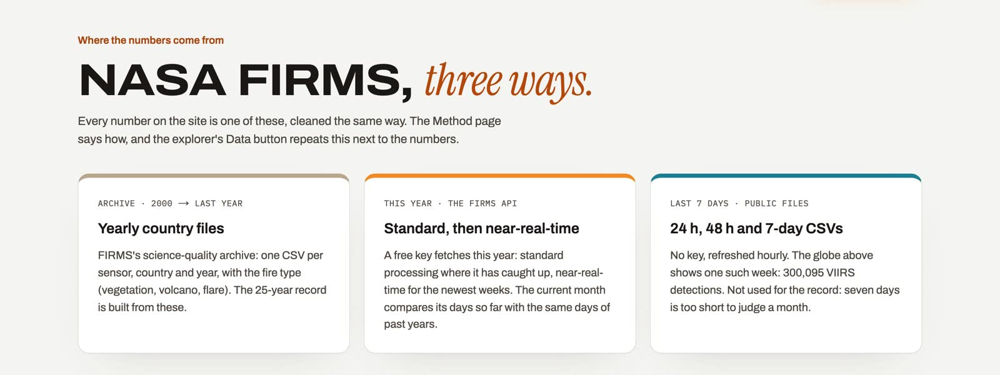

**Other data:** [geoBoundaries](https://www.geoboundaries.org/) (CC BY 4.0) for administrative areas, OpenStreetMap through [Nominatim](https://nominatim.org/) (ODbL) for place search, and [OpenFreeMap](https://openfreemap.org/) for the base map. CONAE, a 2026 Space Apps partner, co-authored the challenge; its Río Negro example is our main case study.

## Use of AI

- **Claude Code** (Anthropic) was used as a coding assistant for the pipeline, backend, web app, tests and documents. Assisted commits carry a `Co-Authored-By: Claude` line.
- **Higgsfield** (Soul stills, Kling image-to-video) made the scene-setting films, stills and portraits on the home page and behind the explorer. They carry no data.
- **Manus AI** made the pixel-art character sprite sheets used in the game and the demo video.
- **Gemma on Cloudflare Workers AI** answers the questions typed into Wel3a's chat. Its pop-up tips are written by us.

The voice narration is a team member's own recording; the music and sound effects are synthesized by our own code.

## Built with

- **Pipeline:** Python 3.12, pandas, NumPy, PyArrow, DuckDB; Parquet and GeoParquet
- **Backend:** FastAPI, DuckDB, Shapely, pyproj, rasterio
- **Web app:** Next.js, React, TypeScript, MapLibre GL, Terra Draw, three.js, GSAP, Lenis, TanStack Query, Zustand
- **Hosting:** Cloudflare Workers (site), a small server behind Cloudflare Tunnel (API), GitHub Actions

## Run it locally

Needs Python 3.12 with [`uv`](https://docs.astral.sh/uv/) and Node 22.

```
scripts/build-data.sh mock                               # builds data/ from the simulated set, no network
cd backend && uv sync && uv run uvicorn app.main:app     # API on http://localhost:8000/api/health
cd frontend && npm install && npm run dev                # site on http://localhost:3000
```

| Folder | What | Tests |
|---|---|---|
| `pipeline/` | simulated data, ingest, grid, harmonization, validation, FIRMS download | `cd pipeline && uv run pytest` |
| `backend/` | FastAPI app (`contracts/api.md`) | `cd backend && uv run pytest` |
| `frontend/` | Next.js web app: landing, explorer, method, game | `cd frontend && npm test && npm run build` |
| `contracts/` | the data and API contracts both sides build against | |
| `docs/` | method, runbook for the real-data build, submission texts | |

GitHub Actions (`.github/workflows/tests.yml`) runs all three (plus frontend lint, typecheck and build) on every pull request and every push to `main`. Every merge to `main` that passes the tests deploys itself (`.github/workflows/deploy.yml`); details in [`deploy/README.md`](deploy/README.md).

## Team

Team Almatafi, NASA Space Apps Cairo 2026: Yassin Ali Salah Ali Ali El Deeb (team owner), Ahmed Hany, Fatema, Hamza Abdelrahman Mohamed Osama Ibrahim Mohamed, Rowaina Mohamed Ahmed, Khalid Osam.

For how we work together, see [`TEAM.md`](TEAM.md); for the build plan, [`PLAN.md`](PLAN.md).
